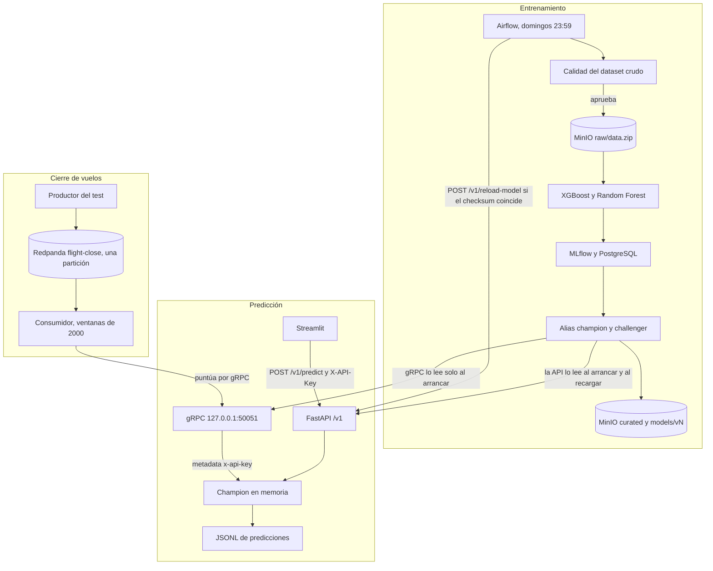

# MLOps2 – Predicción de satisfacción de pasajeros

## Alumna

- Maria Belen Della Casa

## Descripción del proyecto

En el proyecto se implementa un flujo de MLOps a partir del trabajo final de la materia **Operaciones de aprendizaje automático I**.

Los modelos estiman la satisfacción del pasajero a partir de las características del vuelo y del perfil del pasajero. Este repositorio no reutiliza un artefacto ya ajustado: vuelve a entrenar XGBoost y Random Forest sobre esos datos, los registra en MLflow y asigna el alias `champion` al de mayor ROC AUC de test. Ese alias es un XGBoost.

El champion se consulta por REST y por gRPC. REST atiende el pedido de una persona, desde Streamlit o desde Swagger. gRPC lo usa el cierre de vuelos: el conjunto de test se publica en Redpanda y el consumidor puntúa cada pasajero. El aprendizaje federado queda en un script aparte. No se registra en MLflow y no reemplaza al alias.

La plataforma utiliza las siguientes tecnologías:

- Docker
- Docker Compose
- MLflow
- MinIO
- PostgreSQL
- FastAPI
- Pydantic
- Apache Airflow
- Scikit-learn
- XGBoost
- gRPC
- Redpanda

---


## Objetivo general

El objetivo es entrenar de forma reproducible un clasificador de satisfacción, registrarlo en MLflow y servirlo con el alias `champion`. El servicio expone ese modelo por REST y por gRPC, exige una clave para predecir y para recargar, y registra cada predicción válida. Airflow reentrena el domingo a las 23:59 y recarga la API REST si el checksum del artefacto coincide con el tag guardado. El cierre de vuelos puntúa el test por gRPC. MinIO conserva el zip crudo y, al terminar el entrenamiento, una copia de la tabla curada y del artefacto. Esa copia no reemplaza al alias. El promedio federado se simula aparte y no modifica el champion.

---


## Arquitectura general

El servicio tiene tres recorridos conectados. El aprendizaje federado queda fuera de los tres.

El entrenamiento lo dispara Airflow. Lee el zip crudo, entrena XGBoost y Random Forest, y asigna el alias `champion` al modelo de mayor ROC AUC de test. Después copia al mismo bucket la tabla de las ocho columnas y el artefacto de esa versión. La API no usa esa copia: lee el alias.

Esas ocho columnas son `Gender`, `Customer Type`, `Type of Travel`, `Class`, `Age`, `Flight Distance`, `Departure Delay in Minutes` y `Arrival Delay in Minutes`. Los catorce puntajes de la encuesta, en una escala de 0 a 5, quedan fuera del modelo: describen la experiencia del vuelo y están próximos a la satisfacción que se busca estimar. El detalle está en [MODEL_CARD.md](MODEL_CARD.md).

La predicción tiene dos puertas sobre ese alias. Streamlit llama a REST. gRPC responde el mismo contrato, sin pasar por la pantalla. Las dos exigen la clave, validan el cuerpo y agregan la predicción válida al mismo archivo JSONL. Airflow, al terminar, recarga solo la API. gRPC conserva el modelo que cargó cuando arrancó el contenedor.

El cierre de vuelos no entra por Streamlit. Un productor publica cada fila del test en Redpanda y un consumidor la puntúa por gRPC.

`experiments/fedavg_logreg.py` no aparece en el diagrama. Parte el mismo archivo en cinco clientes, promedia una regresión logística y se ejecuta en la terminal del host. No escribe en MLflow, no publica en el broker y no cambia el alias.




La recarga compara el artefacto con el tag `artifact_sha256` de esa versión en MLflow. Si no coincide, la API responde 409 y el modelo que ya está en memoria no se reemplaza. La copia `models/vN/` es la publicación en el lago: el servicio sigue resolviendo el alias.

---


## Servicios disponibles

La API REST y gRPC escuchan solo en `127.0.0.1`. Redpanda no publica un puerto en la máquina: el productor y el consumidor lo alcanzan, dentro de Docker, por el nombre `redpanda` y el puerto `9092`.

Los puertos de MinIO salen de `mlflow_system/.env`. El archivo de ejemplo publica la API S3 en el `9000` y la consola en el `9001`. En este equipo esos valores son `9100` y `9101`, porque el `9000` ya estaba ocupado por otro proceso. Dentro de Docker, MLflow y el entrenamiento siguen usando `http://minio:9000`: el cambio de puerto vale solo para el navegador y para el script de carga que se corre en el host.


| Servicio          | URL                                                      | Descripción                                                                                                                          |
| ----------------- | -------------------------------------------------------- | ------------------------------------------------------------------------------------------------------------------------------------ |
| **Streamlit**     | [http://localhost:8501](http://localhost:8501)           | Pantalla de predicción. Envía la clave y muestra la clase, la probabilidad y la versión del champion.                                |
| **API REST**      | [http://localhost:8000](http://localhost:8000)           | Predicción y recarga. `POST /v1/predict` y `POST /v1/reload-model` exigen el header `X-API-Key`.                                     |
| **API Docs**      | [http://localhost:8000/docs](http://localhost:8000/docs) | Swagger de la API.                                                                                                                   |
| **gRPC**          | `127.0.0.1:50051`                                        | Puntuación interna del cierre de vuelos, con el mismo champion. No tiene pantalla.                                                   |
| **MLflow**        | [http://localhost:5001](http://localhost:5001)           | Experimentos y Model Registry.                                                                                                       |
| **Airflow**       | [http://localhost:8080](http://localhost:8080)           | Reentrenamiento semanal. El grafo se puede abrir sin disparar el DAG.                                                                |
| **MinIO Console** | [http://localhost:9101](http://localhost:9101)           | Consola del bucket en este equipo. Con el `.env` de ejemplo, la misma consola queda en el `9001`. Usuario `minio`, clave `minio123`. |
| **Redpanda**      | `redpanda:9092` en la red de Docker                      | Broker del topic `flight-close`. No tiene pantalla y no abre un puerto en el host.                                                   |


---


## API

La API fue desarrollada con **FastAPI**. Las validaciones de entrada se realizan con **Pydantic**.

`POST /v1/predict` y `POST /v1/reload-model` exigen el header `X-API-Key`. El valor es la variable `API_KEY` del entorno. `GET /health` queda abierto. Las rutas `/predict` y `/reload-model` siguen respondiendo el mismo contrato, también con la clave, hasta retirarlas.

Cada predicción válida se agrega a un archivo JSONL (`PREDICTION_LOG_PATH`, por defecto `/var/log/airline/predictions.jsonl` dentro del contenedor). Un cuerpo inválido responde 422 y no se registra.

### Predicción

```text
POST /v1/predict
X-API-Key: <API_KEY>
```

Ejemplo de request:

```json
{
  "Gender": "Male",
  "Customer Type": "Loyal Customer",
  "Type of Travel": "Business travel",
  "Class": "Business",
  "Age": 41,
  "Flight Distance": 600,
  "Departure Delay in Minutes": 10,
  "Arrival Delay in Minutes": 10
}
```

Ejemplo de response del champion versión 7:

```json
{
  "prediction": 1,
  "label": "satisfied",
  "probability": 0.7946587800979614,
  "model_name": "airline_satisfaction_without_scores",
  "model_alias": "champion",
  "model_version": "7"
}
```


### Health check

```text
GET /health
```


### Actualización del modelo

```text
POST /v1/reload-model
X-API-Key: <API_KEY>
```

La API carga en memoria el modelo `champion` al arrancar. Este endpoint vuelve a leer el alias y reemplaza ese modelo. Airflow lo llama al terminar el reentrenamiento.

Antes de reemplazarlo, la API descarga el artefacto y calcula su checksum. La primera vez lo guarda como tag `artifact_sha256` de esa versión. Si una recarga posterior no coincide con el tag, la respuesta es 409 y el modelo que ya está en memoria sigue siendo el anterior.

gRPC no tiene esta ruta. Carga el champion al arrancar el contenedor `airline_grpc`. Una recarga de la API no lo actualiza: hay que reiniciar ese contenedor.

---


## gRPC

gRPC carga el mismo champion que la API y devuelve la misma predicción: la clase, la probabilidad, el alias y la versión. El archivo del modelo no sale en la respuesta. Lo que cambia es quién hace la llamada.

Una persona pide un pasajero desde Streamlit o desde Swagger. Ese pedido va a REST. Un navegador no utiliza este protocolo, y para un solo pasajero el resultado no cambia. Quien usa gRPC es el consumidor del cierre de vuelos: puntúa un pasajero detrás de otro, dentro de Docker, sin pasar por la pantalla.

El contrato está en `api/scoring.proto`, con los mismos ocho campos. El servidor carga el champion una vez, con el mismo código que REST. Cada llamada envía un pasajero y recibe una respuesta. La clave viaja en la metadata `x-api-key`.

El compose publica el puerto `50051` solo en `127.0.0.1`. Desde otra máquina no se alcanza. El consumidor lo usa por el nombre `grpc`, dentro de la red de Docker, y el puerto en localhost permite comparar las dos puertas desde esta máquina. Dentro de esa red la metadata no va cifrada. Si el puerto saliera de la máquina, el canal tendría que ir con TLS.

La comparación manda el mismo pasajero por REST y por gRPC. Las dos respuestas deben traer la misma clase, la misma probabilidad y la misma versión. El comando imprime además los dos tiempos. Esa salida comprueba que las dos puertas usan el mismo champion. No convierte a gRPC en una segunda pantalla.

```bash
docker compose -f mlflow_system/docker-compose.yml exec grpc python /app/scripts/compare_rest_grpc.py
```

---


## Cierre de vuelos

Redpanda guarda un mensaje por pasajero del test, ordenado por demora de llegada. El topic `flight-close` tiene una sola partición: con más de una, el orden de la demora se mezclaría entre particiones. Streamlit no publica ni lee ese topic.

El productor lee `data/raw/test.csv`. Hay 83 demoras de llegada vacías; se publican como 0, porque el contrato del champion no acepta nulo. El consumidor puntúa cada mensaje por gRPC, con la misma clave. Cada 2.000 predicciones calcula la media. Si esa media cae 0,05 respecto de la primera ventana, imprime la alerta. Las filas que no completan una ventana más no entran en esa cuenta.

Si el consumidor se interrumpe después de puntuar y antes de confirmar el offset, el broker puede entregar ese pasajero otra vez. Dentro de la misma ejecución el consumidor recuerda el identificador de la fila y no lo vuelve a contar. Si el proceso se reinicia, esa memoria se pierde y un mensaje no confirmado puede puntuarse de nuevo.

Primero se ejecuta el productor y después el consumidor. En la consola del consumidor aparecen la media de la primera ventana, la de la última y, si corresponde, la alerta. El grupo `flight-close` confirma los offsets: una segunda ejecución del consumidor no vuelve a leer esos mensajes. Para repetir la lectura hay que cambiar `KAFKA_GROUP`.

```bash
docker compose -f mlflow_system/docker-compose.yml exec streaming python /app/scripts/flight_close_produce.py
docker compose -f mlflow_system/docker-compose.yml exec streaming python /app/scripts/flight_close_consume.py
```

---


## Aprendizaje federado

`experiments/fedavg_logreg.py` simula una alianza de aerolíneas. No se registra en MLflow y no reemplaza al champion. La API, gRPC y el cierre de vuelos siguen puntuando con el XGBoost.

El archivo es de una sola aerolínea. El script parte `train.csv` en cinco clientes, como si cada aerolínea conservara sus filas y enviara únicamente los coeficientes. El modelo que se promedia es una regresión logística con las mismas ocho columnas: el XGBoost no entrega un vector de pesos que pueda promediarse. Hay diez rondas. En cada una, cada cliente ajusta la logística y el servidor promedia los coeficientes según la cantidad de filas. En paralelo se entrena la misma logística con todas las filas juntas.

El reparto es aleatorio, con semilla 42, de modo que los cinco clientes quedan casi iguales. Por eso los dos resultados quedan próximos. La consola imprime `roc_auc_centralizada=0.8342` y `roc_auc_federada=0.8362`. El modelo de la alianza sería ese promedio, y solo si cada aerolínea conserva sus filas. El alias del champion no se modifica.

Hacen falta `data/raw/train.csv` y `data/raw/test.csv`. Desde la raíz del repositorio:

```bash
python3 experiments/fedavg_logreg.py
```

---


## Automatización del modelo con Airflow

El DAG `weekly_airline_retraining` está programado con `59 23 * * 0`: todos los domingos a las 23:59. También admite una ejecución manual. Esa ejecución vuelve a entrenar, puede reasignar el alias `champion` y recarga únicamente la API REST. gRPC conserva el modelo cargado al arrancar `airline_grpc`, hasta que ese contenedor se reinicia.

Para revisar el champion que ya está cargado, se abre [http://localhost:8080](http://localhost:8080), se localiza el DAG y se consulta la vista Graph. No se dispara el DAG.

### Ejecución manual

Si se decide reentrenar desde la interfaz:

1. Abrir [http://localhost:8080](http://localhost:8080).
2. Buscar el DAG `weekly_airline_retraining`.
3. Activar el interruptor de la izquierda para quitar la pausa.
4. Disparar la ejecución con el botón Trigger. Este paso vuelve a entrenar y puede mover el alias.
5. Seguir las tareas en la vista Grid o en la vista Graph:
  - `monitor_raw_data`: validación de calidad del dataset crudo. Si falla, el DAG se detiene.
  - `run_training_pipeline`: reentrenamiento y registro de métricas y artefactos en MLflow.
  - `validate_champion`: comprobación de que el alias `champion` quedó asignado.
  - `reload_api_model`: `POST /v1/reload-model`, con `X-API-Key`, para que la API cargue el alias nuevo.
  - `validate_api`: `GET /health`.
6. Si todas las tareas terminan en `success`, la API REST sirve el champion nuevo sin reiniciar su contenedor. gRPC no recibe esa llamada. Para que las dos puertas sirvan la misma versión, después del DAG hay que reiniciar el contenedor `grpc`.

El orden de las tareas es el siguiente:

```text
monitor_raw_data (Validación de calidad)
        ↓
run_training_pipeline (Entrenamiento)
        ↓
validate_champion
        ↓
reload_api_model
        ↓
validate_api
```

Después de una ejecución exitosa, la API REST utiliza el champion nuevo. gRPC sigue con la versión anterior hasta reiniciar `airline_grpc`.

---


## Robustez, calidad de datos y gobernanza

La calidad del dataset crudo se controla antes de entrenar. El comportamiento del champion ya registrado se audita en una corrida aparte, que no decide el alias. La ficha del modelo está en [MODEL_CARD.md](MODEL_CARD.md): para qué predice, qué columnas usa, el ROC AUC de la versión 7 y los valores medidos de `robustness_audit`.

### Validación del dataset

En el DAG, `monitor_raw_data` corre antes del preprocesamiento. Comprueba que estén las columnas esperadas, rechaza un porcentaje de nulos superior al 10 % en esas columnas, y rechaza edades fuera de 0 a 120 o demoras de llegada negativas. Las demoras están en minutos. Si alguna comprobación falla, el DAG se detiene y no entrena.

### Auditoría del champion

`src/evaluacion/robustness_tests.py` carga el alias `champion` y abre una corrida llamada `robustness_audit` en el mismo experimento. El DAG no la invoca. El alias lo define el ROC AUC de test, durante el entrenamiento.

La corrida aplica tres pruebas y guarda un gráfico SHAP de importancia global como artefacto PNG:

- **Estabilidad.** Agrega ruido gaussiano a las variables numéricas. El umbral para aprobar es una estabilidad superior a 0,90.
- **Paridad de género.** Compara la predicción al fijar `Gender` en `Female` y en `Male`. El umbral es una paridad superior a 0,95.
- **Consistencia de negocio.** Compara la probabilidad con demora de llegada 0 y con 300 minutos. Una demora más larga no tiene que subir la probabilidad de satisfacción. El umbral es una consistencia superior a 0,90.

Si las tres superan su umbral, el tag `robustness_status` queda en `PASSED`.

En el volumen de MLflow de este equipo, esa corrida está en `PASSED`: estabilidad 0,98, paridad de género 1,00 y consistencia de negocio 0,99. Esos tres valores corresponden a esa corrida. El pipeline de entrenamiento no la crea. El ruido de la prueba de estabilidad no tiene semilla, de modo que una auditoría nueva no tiene por qué repetir 0,98. Cada ejecución abre otra corrida con el mismo nombre; no reemplaza a la anterior.

Con el champion ya cargado, la auditoría se lanza así:

```bash
docker compose -f mlflow_system/docker-compose.yml exec training python -m src.evaluacion.robustness_tests
```

---


## Orden de la prueba

Con el compose levantado y el champion ya cargado. No es necesario disparar el DAG: un Trigger vuelve a entrenar. La ficha del modelo está en [MODEL_CARD.md](MODEL_CARD.md).

1. Streamlit, en [http://localhost:8501](http://localhost:8501). La pantalla envía la clave. Un pasajero válido muestra la clase, la probabilidad y la versión 7.
2. Swagger, en [http://localhost:8000/docs](http://localhost:8000/docs). El mismo cuerpo va a `POST /v1/predict`. Sin el header `X-API-Key` la respuesta es 401. Con la clave y `Age` en 200, la respuesta es 422. `GET /health` responde 200 sin clave.
3. MLflow, en [http://localhost:5001](http://localhost:5001). En el registro `airline_satisfaction_without_scores` el alias `champion` es la versión 7, XGBoost, con ROC AUC de test 0,8681. La corrida `robustness_audit` tiene el tag `robustness_status` en `PASSED`: estabilidad 0,98, paridad de género 1,00 y consistencia de negocio 0,99.
4. La misma predicción por REST y por gRPC. Deben coincidir la clase, la probabilidad y la versión.

```bash
docker compose -f mlflow_system/docker-compose.yml exec grpc python /app/scripts/compare_rest_grpc.py
```

1. El cierre de vuelos. Primero el productor y después el consumidor. El productor imprime `publicados=25976`, `particiones=1` y `demora_nula_como_cero=83`. El consumidor tarda unos ocho minutos. Al final imprime `proba_primera_ventana=0.4701`, `proba_ultima_ventana=0.3617`, `alertas_drift=3` y `modelo_version=7`.

```bash
docker compose -f mlflow_system/docker-compose.yml exec streaming python /app/scripts/flight_close_produce.py
docker compose -f mlflow_system/docker-compose.yml exec streaming python /app/scripts/flight_close_consume.py
```

Si el grupo `flight-close` ya confirmó esos mensajes, la segunda lectura usa otro grupo:

```bash
docker exec -e KAFKA_GROUP=flight-close-2 airline_streaming python /app/scripts/flight_close_consume.py
```

1. El federado, aparte del champion. Imprime `roc_auc_centralizada=0.8342` y `roc_auc_federada=0.8362`.

```bash
python3 experiments/fedavg_logreg.py
```

Airflow queda en [http://localhost:8080](http://localhost:8080), DAG `weekly_airline_retraining`. Se abre el grafo y no se dispara el DAG.

## Instrucciones de uso

Si el compose ya está levantado y el alias `champion` ya es la versión 7, el recorrido es el de [Orden de la prueba](#orden-de-la-prueba). No es necesario volver a entrenar ni disparar el DAG. Los pasos de abajo arman el sistema desde un clon, o después de borrar los volúmenes.

### Configuración de variables de entorno

`mlflow_system/.env` no está en Git. Se copia del ejemplo.

En Linux, desde la raíz del repositorio:

```bash
cp mlflow_system/.env.example mlflow_system/.env
```

En PowerShell:

```powershell
Copy-Item mlflow_system/.env.example mlflow_system/.env
```

El ejemplo define `API_KEY=airline-local-key`. Esa clave es la que piden REST, gRPC, Streamlit, la recarga de Airflow y el consumidor del cierre de vuelos. `GET /health` no la pide.

También define `MINIO_PORT=9000` y `MINIO_CONSOLE_PORT=9001`. Si el `9000` está ocupado, hay que cambiar los dos valores antes de levantar el compose. En este equipo quedaron en `9100` y `9101`. Los contenedores no usan esos puertos entre sí: MLflow y el entrenamiento usan `http://minio:9000`, que es el puerto interno del contenedor.

### Datos en MinIO

El entrenamiento lee la clave `raw/data.zip` del bucket `mlflow`. Si `data/raw/` ya tiene el dataset, usa esa copia. Si no está, lo baja del bucket por la red de Docker. No vuelve a buscar el archivo en internet en cada corrida.

El script de carga se corre en el host, con MinIO ya levantado. Si no se le indica otra dirección, busca el servicio en `http://localhost:9000`. El comando, según el puerto, está en el apartado siguiente.

Al terminar un entrenamiento, el pipeline copia al mismo bucket `curated/train.parquet`, `curated/test.parquet` y el artefacto en `models/v<versión>/`. La API no lee esa copia: sigue el alias de MLflow. Si la copia falla, el alias ya asignado no se revierte.

### Levantar el proyecto

La primera vez, o cuando cambian los Dockerfiles o las dependencias:

```bash
docker compose -f mlflow_system/docker-compose.yml up -d --build
```

Si las imágenes no cambiaron:

```bash
docker compose -f mlflow_system/docker-compose.yml up -d
```

Con el compose arriba, se carga el zip si el bucket todavía no lo tiene. En este equipo la API S3 está en el `9100`:

```bash
MLFLOW_S3_ENDPOINT_URL=http://localhost:9100 python3 scripts/seed_minio.py
```

Con el `.env` de ejemplo, sin cambiar el puerto, el mismo script es `python3 scripts/seed_minio.py`. Si `data/raw/data.zip` no existe, lo descarga una vez. Si `raw/data.zip` ya está en el bucket, no lo vuelve a subir.

El build necesita unos 10 GB libres. Redpanda no usa un volumen de Docker. El compose monta `/var/tmp/airline_redpanda` porque, en este equipo, el directorio de datos de Docker está en un home cifrado y ese disco rechaza la escritura directa que Redpanda exige al arrancar. `/var/tmp` está en otra partición. El contenedor corre como root para poder escribir en ese directorio.

En una instalación nueva, o después de `down -v`, MLflow todavía no tiene un modelo. El entrenamiento se corre una vez:

```bash
docker compose -f mlflow_system/docker-compose.yml exec training python -m src.pipeline
```

Ese comando prepara los datos, entrena XGBoost y Random Forest, los evalúa, los registra en MLflow y asigna los alias `champion` y `challenger`. No crea la corrida `robustness_audit`. Esa auditoría se lanza después, con el comando indicado en la sección de auditoría del champion, y los valores 0,98, 1,00 y 0,99 son los de la corrida ya guardada en este equipo.

La API y gRPC cargan el alias al arrancar. Si el entrenamiento terminó con los dos contenedores ya en marcha, hay que reiniciarlos para que los dos lean el champion nuevo:

```bash
docker compose -f mlflow_system/docker-compose.yml restart api grpc
```

`GET http://localhost:8000/health` responde 200 sin clave cuando la API tiene el modelo en memoria. PostgreSQL y MinIO guardan experimentos y artefactos en volúmenes, así que un `up` posterior no vuelve a entrenar.

El contenedor `airline_streaming` permanece en ejecución y no publica mensajes por sí mismo. El productor y el consumidor se lanzan con los comandos del cierre de vuelos. El federado se corre en el host, con `data/raw/train.csv` y `data/raw/test.csv`, y no necesita el compose.

### Detener el proyecto

```bash
docker compose -f mlflow_system/docker-compose.yml down
```

PostgreSQL, MinIO y Airflow conservan sus volúmenes. Los mensajes de Redpanda quedan en `/var/tmp/airline_redpanda`.

```bash
docker compose -f mlflow_system/docker-compose.yml down -v
```

`down -v` borra los volúmenes. Se pierde el registry, y hay que volver a entrenar y a reiniciar `api` y `grpc`. No borra `/var/tmp/airline_redpanda`. Para vaciar el topic hay que borrar ese directorio con el contenedor de Redpanda detenido.

---

